<h1 align="center">🎻 Ensemble</h1>

<b>Drives Claude's Code sessions from across the room with only a webcam.</b>

Works with 

## Features

<b>Focus follows your nose</b> Look at a session and it takes focus, so every gesture lands where you are looking.

<b>Dictate and send hands-free</b> A double thumb-index pinch starts and stops Claude's own dictation, and a held thumbs-up sends the draft.

<b>Scroll with one hand</b> Pinch and drag to scroll the session, and flick for momentum.

<b>Fits the chat column</b> A session you look at widens enough to read, a peace sign widens it to the chat's default width and no further, and scissors share the window evenly.

<b>Always shows its state</b> A capsule at the top of the screen names the state and the session, so nothing happens by surprise.

<b>Quiet while you talk</b> Other audio on your speakers pauses while you dictate, then comes back.

<b>A first-launch tour</b> A short tour teaches each gesture while nothing reaches Claude.

## Fit

Use it when:

- You run several Claude Code sessions and want to pick one by looking at it.
- Your hands are busy or tired and you still want to dictate a prompt and send it.
- You sit far enough from the keyboard that reaching for it breaks your flow.

Look elsewhere when:

- You want voice or pointer control of every app, not only Claude.
- You use an Intel Mac or a macOS older than 14.2.
- You use Claude in a browser, since Ensemble drives the desktop app only.

It needs an Apple Silicon Mac with macOS 14.2 or later, a webcam that sees your face and your hands, and Claude desktop with Code sessions.

To install, download the disk image from the [latest release](https://github.com/oficiallyAkshay/ensemble/releases/latest), drag Ensemble to Applications and open it, then, because the app is not notarized yet, choose Open Anyway in System Settings under Privacy and Security. The tour opens on first launch; [setup and calibration](docs/setup.md) covers every install step, calibration, saved setups and more than one screen.

## How it compares

| | [oficiallyAkshay/ensemble](https://github.com/oficiallyAkshay/ensemble) | [FlorianRiquelme/sleight](https://github.com/FlorianRiquelme/sleight) | [google/project-gameface](https://github.com/google/project-gameface) | [Apple head pointer and Voice Control](https://support.apple.com/guide/mac-help/use-head-pointer-mchlb2d4782b/mac) |
|---|---|---|---|---|
| Platform | macOS | macOS | Windows, Android | macOS |
| Input | Face, hands | Hands | Head, face | Head, voice |
| Built for | Claude sessions | Shortcuts | Games | Desktop |
| Install | Disk image | Source | Zip | Built in |

## Security and limits

No credential: everything runs on your Mac, and Ensemble asks only for Camera and Accessibility, plus the microphone if you turn on the optional live sound bars.

- Never stores or sends a camera frame.
- Never records your dictation or your screen; it logs events and numbers only.
- Never reaches the internet from the face tracker page.
- Never updates itself unless you turn on Update automatically or press Check for Updates, and installs only updates signed with its own key.
- Sends no crash reports, and one anonymous usage report a day (counts of gestures, refusals and safety stops, versions and the camera format, under a random id; never video, text, names or titles). Turn it off in Settings, General, Privacy; every field is in [docs/telemetry.md](docs/telemetry.md).
- Never acts on another app, except pausing other audio while you dictate.

Headphone presses (Bluetooth only) are explained in [Gestures and settings](docs/gestures.md#headphone-presses).

Defaults, each with its way out. A gesture or two quick Returns send only with Claude in front, within 30 seconds of dictation ending, into the session you dictated into, with nothing typed or clicked since; set Send to Off in Settings, Actions. Other audio pauses while you dictate; turn it off in Settings, General. Pointing corrects for where you sit, assuming true distances from the camera and upright monitors; turn it off in Settings, Display, Correct for where I sit. Headphone presses are on; turn them off in Settings, Actions.

Known limits: a Claude update that renames its controls can break Ensemble until it is updated; pointing picks a session, not a line of text, and a screen turned far from the others is less accurate; a second face in view pauses every gesture.
